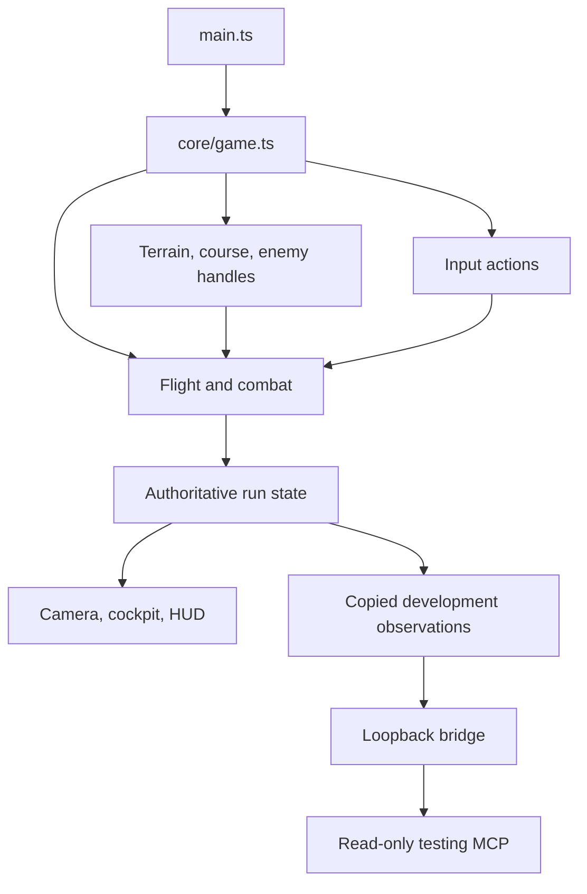

# Application architecture

## Runtime and build

Create a small static browser application using strict TypeScript, Vite, and npm-installed `three@0.180.0`. This follows the existing TypeScript/Node repository conventions and replaces the older planning archive's no-build JavaScript/import-map approach. Gameplay runs in the browser; a production application backend is unnecessary.

Use Node.js `>=22.12`. Use the compatible exact dependency versions recorded in [agent-setup.md](agent-setup.md), including matching `@types/three@0.180.0`, and commit `package-lock.json`. Check the selected package versions' own Node requirements; do not add a dependency that requires a newer runtime without documenting that change. Keep the dependency set modest. No framework, physics engine, entity-component system, state library, post-processing suite, or asset loader is needed for this MVP.

`index.html` is a thin canvas/DOM shell with one module entry to `src/main.ts`. External CSS owns presentation. Runtime code belongs in `src/`, documentation in `docs/`, and checks in `tests/` and raw local evidence under ignored `artifacts/acceptance/`. Keep browser and Node tooling type-check configurations separate so Node-only bridge/MCP modules never enter the browser bundle. Provide the actual `dev`, `typecheck`, `lint`, `test`, and `build` scripts when implementation starts; commands listed in the initial repository scaffold are not proof that those scripts already exist.

## Planned files and ownership

These are implementation targets, not claims that runtime code exists in this planning change.

| Path | Responsibility |
|---|---|
| `index.html` | Page shell, canvas and HUD/overlay anchors, module entry |
| `styles/main.css` | HUD, overlays, layout, gauge labels when needed, hit/damage indicators |
| `src/main.ts` | Resolve DOM anchors; instantiate the game exactly once |
| `src/config.ts` | Typed immutable tuning, palette, default seed, world/course/combat limits |
| `src/types.ts` | Small shared types for run mode, flight state, spawn records, events, and handles |
| `src/core/game.ts` | Compose modules; own renderer, scene, camera, run state, transitions, resize, and the sole frame loop |
| `src/core/input.ts` | Install input listeners once; expose held actions and edge commands; clear input |
| `src/systems/flight.ts` | Update pose/speed from input and bounded delta time |
| `src/systems/combat.ts` | Hitscan, health, score events, cooldowns, enemy projectile updates, and bounded combat effects |
| `src/world/terrain.ts` | Seeded terrain/sky/lights/fog/clouds; shared height query, terrain collision helpers, and bounds |
| `src/world/course.ts` | Seeded route/rings/spawn, ordered segment crossings, and ring appearance |
| `src/world/enemies.ts` | Reusable tank/blip meshes, colliders, immutable spawns, and simple live blip transforms |
| `src/view/cockpit.ts` | Camera-attached cockpit, two muzzle anchors, live gauge/boost handles |
| `src/view/hud.ts` | Bind DOM actions once; render state and overlays; no game-rule ownership |
| `src/dev/contracts.ts` | Shared serializable observation types/schema; no game-state ownership |
| `src/dev/diagnostics.ts` | Read-only copied snapshots and bounded events through the development-only browser observer |
| `src/dev/telemetry.ts` | Publish copies of development state/events at no more than 5 Hz; never own simulation |
| `tools/dev-bridge.ts` | Vite development bridge for loopback read-only telemetry routes |
| `tools/game-test-mcp/server.ts` | Stdio MCP server exposing the bounded read-only game observation tools |

Keep small vector, random, or drawing helpers local until a real second caller justifies extracting them. A small controller class or ordinary functions are both suitable. No module may start a second `requestAnimationFrame`, construct another renderer, or call the controller through a circular import.

## Composition and data flow

The editable source for this diagram is [diagrams/runtime-flow.mmd](diagrams/runtime-flow.mmd).

The controller passes state and handles to systems. Systems do not query DOM elements or import the controller. View modules read state; DOM buttons enqueue controller actions. The observer reads copies after a settled update. Tooling failure must not stop a run, change its numbers, or make the browser wait for a network request.

## State boundaries

| Group | Contents | Lifecycle |
|---|---|---|
| Configuration | Seed, speeds, limits, colors, tuning | Immutable for a run |
| Scene handles | Renderer, scene, camera, meshes/materials, rings, enemies, cockpit, muzzle anchors | Reused on Retry |
| Spawn records | Initial player pose, ring transforms, enemy positions/phases/health | Immutable and seeded |
| Run state | Mode, pose/previous pose, speed, active and simulation time, ring index, hull, kills, score, enemy numeric state, shot deadlines | Reset from configuration and spawn records |
| Input | Held steering/boost/fire; queued start/pause/resume/retry | Cleared at transitions |
| Effects | Projectiles, tracers, flashes, fragments if used, feedback timers | Bounded; cleared on Retry |
| Observations | Copied snapshots and a bounded event buffer | Development only; no writes to gameplay |

The controller is the sole transition authority. Flight owns pose and speed changes, course owns checkpoint changes, and combat owns damage, enemy health, and scoring. Those systems return/report a reason or event to the controller; they do not independently transition modes. HUD values are derived from the run, never separately counted in DOM state.

Do not clone a Three.js scene to reset. Restore numeric state and visibility from immutable spawns. A `runId` or equivalent observation identity may distinguish retries for tooling, but must not change the world seed.

## Coordinates and camera

Use Y up and negative local Z forward. Derive the flight direction from heading and pitch. Apply decorative roll to the camera for bank; do not also rotate the velocity by a second roll-based turn model. The cockpit group is a camera child. Its local positions remain stable through a bank. Keep near/far planes suitable for both cockpit and canyon; avoid a near plane that clips the panel or a field of view so wide that the cockpit obscures the route.

After moving the aircraft, copy its pose to the camera and update scene/camera world matrices before reading the reticle ray, enemy raycast positions, or either muzzle's world position. Cockpit meshes are excluded from gameplay collision queries.

## Two clocks, one update

Maintain two explicit notions of time:

- **Active elapsed wall time:** accumulate `performance.now()` deltas only while `running`. Use it for the 90-second deadline and player/enemy firing deadlines. Pausing excludes time; resuming rebases the previous timestamp.
- **Simulation time:** accumulate a bounded movement delta, initially `min(activeFrameDelta, 0.05)` seconds. Use it for flight movement, blip oscillation, projectile movement/lifetime, and short-lived visual effects.

This keeps the countdown honest after a frame stall while limiting large movement steps. It does not promise real-time flight distance during severe stalls. A due emitter produces at most one shot per rendered update and sets its next deadline to `activeNow + interval`; never replay a missed backlog. Blip motion and projectile lifetime use simulation time consistently, so pause freezes them and an ordinary hitch does not teleport a target or advance a projectile farther than its collision segment.

In menu, paused, and terminal modes, render the current view but do not advance either game clock. Keep normal resize and overlay input working.

## Ordered frame contract

1. Process queued actions. Any start/resume/retry action rebases the wall timestamp; it must not inherit time from the preceding mode.
2. If running, advance active time. If it reaches 90 seconds, fail with `timeout` before moving or awarding a ring.
3. Save the previous player position; update flight and the living blip transforms using the bounded delta. Advance simulation time.
4. Apply the camera pose and update world matrices.
5. Check terrain contact and finite X/Z bounds. A failure stops gameplay processing for this update.
6. Resolve due player shots, then move existing enemy projectiles and apply their earliest collisions. If hull reaches zero, fail before awarding a ring. Living enemies can then attempt due return fire; newly spawned projectiles start moving on the next update.
7. If still running, test the active checkpoint with the previous-to-current movement segment. Emit at most its one valid passage and win after the tenth ring.
8. Settle state/events; update gauges, HUD, overlays, and any development snapshot; render once.

Stop later simulation work as soon as a failure or win is requested and committed. Multiple conditions in one update produce one terminal transition. The same ordering applies under normal input, browser automation, and observation.

## Terrain and collision agreement

Generate the terrain mesh from a fixed grid of heights. Implement `heightAt(x, z)` by interpolating the same triangle diagonal and vertex heights used by the mesh, or otherwise prove that the query and geometry agree within the collision margin. A smooth procedural source function evaluated independently of a coarse mesh can disagree visibly; do not use that mismatch for collision or tank placement.

For aircraft ground contact, compare clearance against the configured 3 m vertical margin and check the movement segment against that surface. One practical method is a segment ray against the terrain with both endpoints lowered by the margin, plus endpoint clearance checks. Bounds are explicit; do not clamp the player back into the map silently.

For projectiles, share the rendered terrain grid/collision helpers. Short projectile segments can examine only the grid cells they cross; avoid a full terrain mesh scan for every projectile on every frame when a local grid query suffices. Player hitscan and infrequent enemy line-of-sight queries may use a terrain raycast. No additional collision engine is needed.

## Checkpoint crossing

Each ring has an immutable center `C`, a unit plane normal `N` pointing along intended route travel, and a clear opening radius `r`. Keep collision math separate from the decorative torus thickness.

For previous and current aircraft centers `P0` and `P1`, calculate signed plane distances `d0 = dot(P0 - C, N)` and `d1 = dot(P1 - C, N)`. Accept a forward crossing only when `d0 < 0` and `d1 >= 0`. The crossing parameter is `t = d0 / (d0 - d1)`; evaluate `Q = P0 + t * (P1 - P0)` and require its in-plane radial distance from `C` to be at most `r - aircraftMargin`. Use the configured 3 m margin as the starting value.

Advance only the currently active ring, once. A future ring, reverse crossing, tangential movement, or proximity without a plane crossing does not count. With the bounded movement step and stated ring spacing, one active ring per update is sufficient. This rule prevents boost or a low frame rate from skipping checkpoint detection, and prevents counting the ring while clipping its rim.

## Combat boundaries

The camera-center ray is the authoritative player aim. The selected gun muzzle is a cosmetic tracer origin. A shot resolves the nearest living target only if it is closer than terrain and within range; cockpit, rings, other effects, and destroyed enemies are excluded.

Enemy projectiles are moving hazards. Sweep each existing projectile from its previous to next position, compare terrain and aircraft collision times, and consume it at the earliest collision. For the aircraft, use relative projectile/player movement against the configured aircraft sphere rather than only checking the endpoint. Terrain wins a tie. Combat tuning and reset details are in [combat.md](combat.md).

## Mode transitions and reset

See [diagrams/run-states.mmd](diagrams/run-states.mmd) for the state graph. Start/Retry create fresh run state while reusing scene resources. Pause/focus loss clears held input and freezes both clocks. Resume is explicit. Win/fail freezes the result and clears firing input.

Retry restores current and previous pose, speed, both clocks, countdown, first ring, hull, all score/kill counts, living enemies at initial position/phase/health, initial enemy fire deadlines, ready player fire, and the first muzzle index. Clear every projectile and temporary visual. Restore ring/enemy visibility. Leave one renderer, one listener registration per action, and one frame loop in place.

Dispose geometries, materials, textures, listeners, and the renderer only when destroying the application, not on every run. Keep temporary geometry/material ownership explicit and bounded.

## Development observation and verification

Implement the observer after the playable loop. The exact contract lives in [game-testing-mcp.md](game-testing-mcp.md). Development exposes `window.__flightDebug.snapshot()` and `events({instanceId, after, limit})` as copied read-only data. Telemetry publishes at no more than 5 Hz through Vite's existing HMR connection with `import.meta.hot.send('flight:telemetry')`; the MCP reads the loopback health/state/events routes. No new browser socket or HTTP publish endpoint is required. Its three tools are `flight_get_status`, `flight_get_state`, and `flight_get_events`. Production must expose neither the diagnostics object nor development routes.

The bridge and MCP run in Node, outside the browser bundle. Do not add generic JavaScript evaluation, state setters, teleport, invulnerability, fabricated kills, or a remote game-control API to this read-only observer. The browser agent uses real UI input. Numerical assertions and visual screenshots cover different evidence; both matter for a 3D canvas.

Use [agent-setup.md](agent-setup.md) for agent-browser and [tests/smoke.md](../tests/smoke.md) for verification. Add only focused automated checks for concrete mathematical/lifecycle risks, such as ordered ring crossing, terrain occlusion, once-only scoring, clock pause/resume, and retry reset. Use the Node built-in test runner through `tsx` as documented in [agent-setup.md](agent-setup.md); no Vitest dependency is required. Follow the repository testing skill instead of building a broad testing platform.
