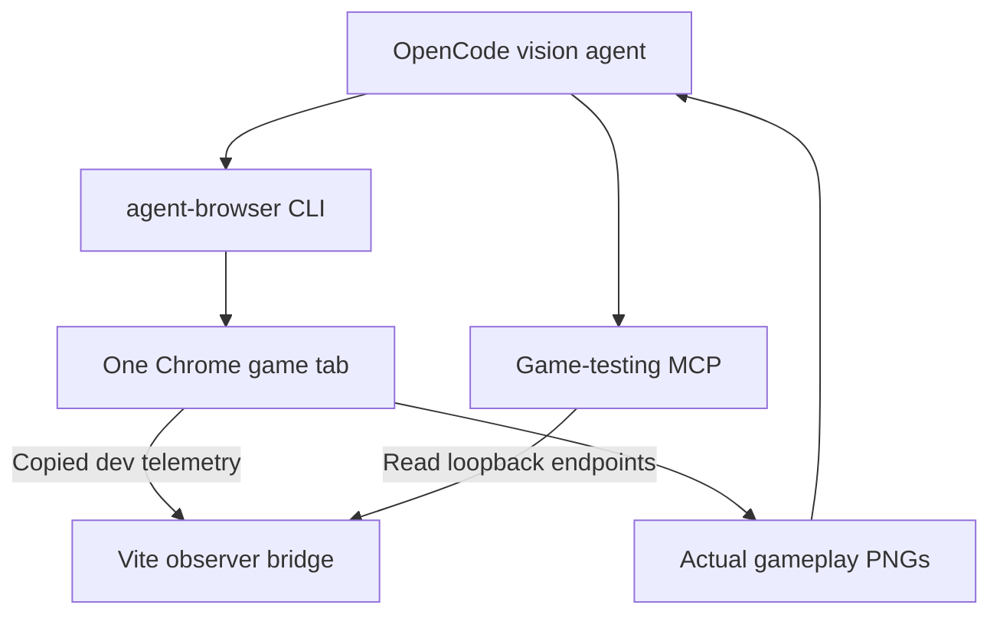

# Game-testing MCP plan

Status: **specified, not implemented**. The final MVP handoff includes this small development observer. It is not a public service or an alternative game controller.

## Architecture

Agent-browser is the sole browser owner. It drives ordinary keyboard/mouse inputs and captures screenshots. The MCP reads the same tab's game state via the Vite dev server. It never launches Chrome, connects a second Playwright/CDP session, or invokes a browser command.

Choose the Vite bridge over wrapping `agent-browser eval` inside MCP tools: it gives structured state reads without competing command execution or an arbitrary-JavaScript tool. The small `window.__flightDebug` reader remains useful for direct debugging if the MCP is temporarily unavailable; it does not replace final MCP acceptance.

## Files and dependencies

- Shared types and browser data: [diagnostics contract](diagnostics.md).
- Vite plugin: `tools/dev-bridge.ts`; register only for development `serve`, using `configureServer` and a `flight:telemetry` WebSocket listener.
- MCP entry: `tools/game-test-mcp/server.ts`, run with `tsx` via `npm run --silent mcp:game`.
- Use the official **v2** `@modelcontextprotocol/server` SDK, its `StdioServerTransport`, and a Standard Schema-compatible validator such as Zod v4. Pin exact compatible versions in the Phase 0 lockfile. Do not mix v1 `@modelcontextprotocol/sdk` example imports with v2.
- Node's built-in `fetch` is sufficient. No Express, database, message broker, separate browser package, or web-hosted MCP is needed.

The SDK and browser automation are development dependencies and must not enter the browser production bundle. Keep stdout exclusively for MCP protocol messages and send diagnostics to stderr.

## Dev endpoints

Bind the Vite development server to **127.0.0.1:5173**, with `strictPort: true`. Reserve these read endpoints before Vite's HTML fallback so missing telemetry returns JSON instead of `index.html`.

| Endpoint | Result |
| --- | --- |
| `GET /__flight/health?session=flight-school` | Bridge readiness, schema version, available live instance IDs, freshness summary |
| `GET /__flight/state?session=flight-school&instanceId=...` | Latest copied snapshot with receipt metadata |
| `GET /__flight/events?session=flight-school&instanceId=...&after=0&limit=20` | Bounded event page and gap/cursor metadata |

No mutation endpoint is required. The browser publishes through Vite's existing dev connection, as defined by the diagnostics contract. Only the in-memory observer cache changes; the bridge cannot change the simulation.

Common result metadata: `schemaVersion: 1`, `source: 'live_game'`, `instanceId`, `runId`, `publicationSequence`, `receivedAt`, `ageMs`, and `stale`. Compute age using the server's receipt clock; do not subtract timestamps from different processes. Mark stale after **2,000 ms** without receipt. Retain no data after dev-server shutdown.

The `session` label and explicit `instanceId` prevent reading another tab's run. With no explicit instance, exactly one fresh instance must exist. Multiple fresh instances return `AMBIGUOUS_INSTANCE`. When the caller supplies an instance, return that instance's fresh state or an error; never switch to another. Reuse the current instance across retries but expect `runId` to change. A reload requires reselecting its new instance.

Validate received shape, finite numbers, supported version, sequence monotonicity, event count, and payload size (maximum **32 KiB**). Retain at most four recent instances and expire inactive caches after five minutes. Ignore duplicate/out-of-order envelopes for the same instance. Serve `Cache-Control: no-store`. Keep requests on loopback, retain Vite's origin restrictions, and do not enable wildcard CORS. This is a local diagnostic facility, not an authentication design for a production endpoint.

## Three MCP tools

Use descriptive fixed tools with small schemas. Declare read-only and non-destructive annotations supported by the SDK.

| Tool | Inputs | Response |
| --- | --- | --- |
| `flight_get_status` | Optional `session` (default `flight-school`) | Bridge status and live instance choices; makes absence/staleness explicit |
| `flight_get_state` | Optional `session`; required `instanceId`; `detail: 'summary' | 'full'`, default summary | Summary contains identity/timing/mode/player/course/combat/renderer; full additionally includes six enemy records and at most 24 projectile records |
| `flight_get_events` | Optional `session`; required `instanceId`; nonnegative `after`; integer `limit` 1–50, default 20 | Event page, run identity, freshness, gap and cursor fields |

The server base URL is fixed by `FLIGHT_TELEMETRY_URL`, default `http://127.0.0.1:5173`. Validate that it is the configured loopback origin. Tool callers cannot supply arbitrary URLs, paths, shell commands, JavaScript, file destinations, or HTTP methods. Fetches have a **2-second timeout** and no redirect following. Return bounded structured content plus a short text summary; do not duplicate a large snapshot in both forms.

Use explicit error codes: `BRIDGE_UNAVAILABLE`, `NO_GAME_INSTANCE`, `AMBIGUOUS_INSTANCE`, `STALE_STATE`, `INSTANCE_NOT_FOUND`, `SCHEMA_MISMATCH`, and `INVALID_ARGUMENT`. `flight_get_status` can describe unavailable/stale data; state/event calls must not present stale values as a successful fresh observation. Include available age/identity in the error to aid recovery. A normal paused or finished run can still be fresh.

## OpenCode activation

The root config reserves the server **disabled** because this planning change contains no server entry point yet. During implementation:

1. Finish the live browser snapshot and bridge; verify their data with ordinary input.
2. Implement the three MCP tools and package script.
3. Remove `disabled: true` from this server only; preserve other project/user configuration.
4. Use OpenCode V2's `opencode mcp list` and a live tool call to verify the connection and advertised names. Keep direct tool exposure (`codemode: false`) for this small tool catalog unless an actual model comparison justifies changing it.
5. Record one real status/state/event read and the matching page/run identity. A configured process or successful tools-list response alone does not prove game observation.

Use `protocol: 'auto'` so the OpenCode V2 client negotiates with the v2 SDK. Do not silently switch SDK major generations to repair a mismatch; check their documented APIs and actual installed versions.

## Focused acceptance

- Start one named browser session at the debug URL. Obtain its instance ID from status and use it for all reads.
- Start the game through the actual button; observe a new run and changing position/time.
- Use real gun inputs; observe a tank's two hits and one 200-point award, and a blip's one hit and one 100-point award.
- Pause through Escape; two fresh observations show unchanged simulation time/tick, hull, pose, and live projectiles. Resume without a firing backlog.
- Retry; observe a new run ID, reset counters/health/enemies, and a continued diagnostic event sequence.
- Close the tab or stop telemetry; a later read reports stale/missing, rather than another tab's state.
- Query a deliberately old event cursor and confirm an explicit gap if history has rolled over.
- Confirm production preview has no debug object or `/__flight/` JSON API.

Use one or two focused contract tests for validation/cursor semantics only if needed to cover a concrete defect risk. Do not build a second simulator, generic test orchestration platform, or tests for the MCP SDK itself.
