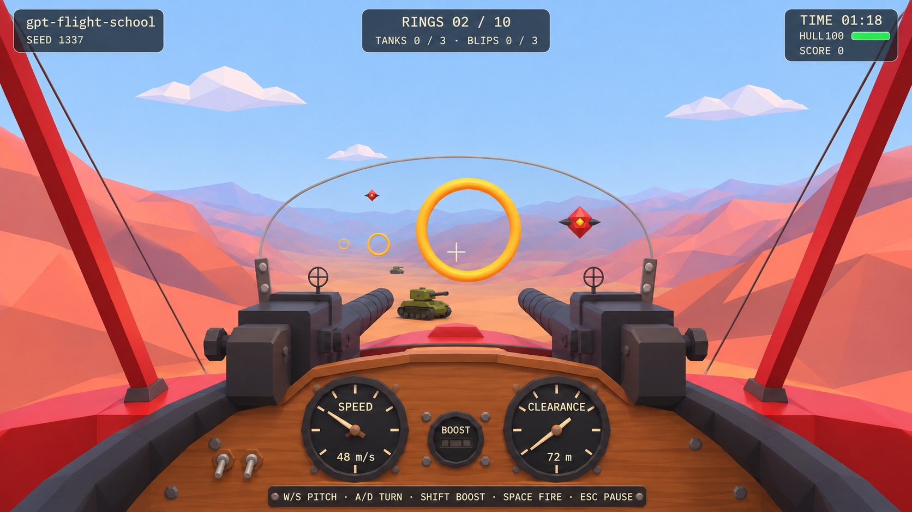

# Visual acceptance contract

## Canonical concept references

These three images are the agreed visual targets for the MVP. They supersede earlier dashboard/disc concepts. They are generated design references, not screenshots of an implemented game or evidence that tests passed.

| Image | Acceptance role |
|---|---|
| [01-level-flight.png](reference-images/01-level-flight.png) | Primary cockpit shape, framing, palette, ring route, and enemy silhouettes |
| [02-ground-combat.png](reference-images/02-ground-combat.png) | Downward tank engagement, muzzle/tracer feedback, small destruction effect, and return fire |
| [03-air-combat.png](reference-images/03-air-combat.png) | The same cockpit during a bank, boost, airborne engagement, and live combat HUD |

Numeric labels, terrain details, exact aim poses, and particle shapes in the concepts are illustrative. The running simulation and [combat contract](combat.md) determine the real values. Acceptance is based on visible features and coherent behavior rather than pixel similarity to generated art.

## Cockpit identity and composition

The player should feel seated in a vintage open biplane cockpit inspired by the user's reference. Preserve all of these major shapes:

- Red-painted outer side struts and red airframe shoulders.
- A few thin rigging wires along the sides.
- Warm brown, gently arched wooden dashboard with a dark padded cockpit rim.
- A low, curved clear windscreen with a thin rim and restrained blue edge tint.
- Two visible charcoal gun receivers and simple forward barrels, one on each side of the centerline.
- Two round black analog gauges with cream ticks, live needles, and readable values; a small boost lamp between them.
- An open central aiming channel between the guns, aligned with the screen-center reticle.

The panel occupies roughly the lower 30–35% of a 16:9 image. Guns extend above it without filling the center. Outer struts frame the sides; a central strut must not block the flight line. A flat strip of gauges alone does not meet this cockpit contract.

Build it as a camera-attached group of primitive meshes. A few beveled-looking faces are enough. Wood can be flat brown polygons with slight tonal variation. No photographic wood texture, realistic bolts, complex switches, reflections, refraction, or model download is needed.

Glass may be a transparent curved segment with a simple outline. Keep transparency/depth settings from obscuring enemies or rings. Prefer a barely visible pane over a large opaque blue overlay. The cockpit must stay fixed relative to the camera while the world banks. HUD text remains screen upright.

Use a small procedural canvas texture for gauge ticks/labels, plus a live mesh needle; alternatively, use aligned DOM labels and needles over modeled gauge faces. Both gauges need actual numerical readouts. Use speed in m/s and **clearance above terrain**, not an unrelated altitude. Needles respond to their corresponding values, and the boost lamp changes with boost input while running.

## Environment and color

The world is a continuous low-poly canyon, with warm terracotta, coral, and ochre walls; a sandy valley floor; pale blue sky; a few faceted clouds; warm directional light; and cool distance fog. Broad coherent terrain silhouettes matter more than high polygon counts or heavy texture noise.

A practical starting palette is coral `#D87969`, terracotta `#B85845`, sand `#E8AD70`, sky `#9CCAF1`, distant haze `#A7B2D5`, red airframe `#B9292E`, warm wood `#85502B`, charcoal `#303139`, cream UI `#FFF0C7`, and amber rings `#FFBE24`. These are design starting values, not sampled measurements or exact color requirements.

Use flat shading and simple lighting. Keep enough contrast between near slopes and distant terrain to read depth at flight speed. Do not use an acceptance image as a skybox, canvas background, or replacement for live terrain/cockpit geometry.

## Silhouettes and effects

| Object | Visible contract |
|---|---|
| Checkpoint | Hollow amber torus; active ring visibly brighter; route beyond remains readable |
| Tank | Grounded olive hull, two dark tracked sides, turret, and short barrel |
| Airborne blip | Crimson faceted diamond/drone body, small dark fins, warm core; visible motion |
| Player shot | Brief amber muzzle flash alternating between the two guns; thin tracer toward the resolved shot endpoint |
| Enemy shot | Small clearly visible red moving projectile or short trail |
| Hit confirmation | Brief cream mark near the center; restrained and readable |
| Destruction | Small flash/pop or a few bounded polygon fragments |

Targets need useful apparent size during an approach. Tanks must sit on the terrain rather than float or hide underground; blips must be real moving 3D targets rather than static HUD symbols. Their shape and position should distinguish them even without relying on color.

Effects must correspond to real events. A tracer on a miss may reach the configured aim endpoint; a hit tracer must end at the resolved surface/target. Do not show a cinematic explosion for every frame of held fire or leave fragments accumulating across retries.

## HUD placement and legibility

Use compact dark translucent navy panels with cream text and restrained borders:

| Position | Contents |
|---|---|
| Top left | `gpt-flight-school`, active seed |
| Top center | Ring progress; separate tank and blip kill counts |
| Top right | Time remaining, hull number/bar, score |
| Center | Thin cream reticle aligned with the hitscan ray |
| Cockpit panel | Round speed and clearance gauges; boost status |
| Lower panel | Brief controls hint when it fits without covering instruments |

Prefer stable widths for counters and timer to avoid layout jumps. At the chosen desktop acceptance size, no text or gauge is clipped. Start, pause, and results use actual DOM controls and concise readable instructions. Ensure the overlay fits after a window resize. A responsive desktop layout is required; dedicated mobile controls are outside scope.

## Priority and pass/fail rubric

Review at a practical 16:9 desktop viewport, `1440 × 810`, with seed `1337` and a visible app version/commit recorded in the evidence notes. Keep that viewport consistent for the three capture cases.

| Priority | Pass condition | Material failure |
|---|---|---|
| 1. Cockpit | Wood arch, dark rim, red side framing, curved windscreen, twin guns, round gauges are recognizable together | Flat HUD-only cockpit, missing twin guns, or wrong cockpit identity |
| 2. Sightline | Reticle and next ring can be seen through a clear forward channel | Panel, guns, glass, or central strut covers the aim/course |
| 3. World | Live faceted canyon with coherent valley and visible fog depth | Disconnected random spikes, featureless plane, or concept image used as scenery |
| 4. Targets | Grounded tank and airborne blip silhouettes are readable | Generic cubes, floating tanks, hidden targets, or HUD-only blips |
| 5. Motion/feedback | World banks behind stable cockpit; gun feedback aligns with real hits; targets visibly move | Rotating HUD, detached effects, misleading tracers, or static fake combat |
| 6. Instruments | Needles, readouts, boost, hull, time, progress, and score reflect game state | Decorative frozen gauges or hard-coded counters |

Exact terrain contours, rivets, shadow placement, wood grain, polygon counts, and the concepts' numeric labels are not pass/fail requirements. Simplifying those details is compatible with the MVP. Missing a priority feature is not.

## Capture protocol

Use [agent-browser setup](agent-setup.md), the model's image/vision capability, and [tests/smoke.md](../tests/smoke.md). Capture actual gameplay in three states:

1. **Level flight:** cockpit fully visible, active ring ahead, enough terrain to judge depth and framing.
2. **Ground combat:** an identifiable grounded tank and authentic shot/hit feedback; the HUD reflects the actual state.
3. **Air combat:** a modest bank, airborne target engagement, and boost if used; the cockpit remains stable.

Save evidence under `artifacts/acceptance/` according to the test plan, and record seed, viewport, run/state time, and build/commit. Numeric observations from [game-testing-mcp.md](game-testing-mcp.md) can establish that damage or kills occurred; screenshots establish what was rendered. A text accessibility tree cannot evaluate a WebGL cockpit.

When a capture reveals a defect, fix the specific issue and recapture that case. Do not start an open-ended art polish loop after the required composition and behavior are demonstrated. Never rename these concepts as gameplay evidence.
